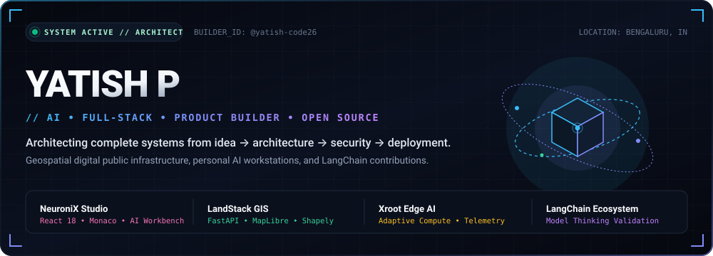
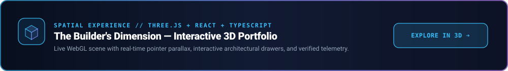
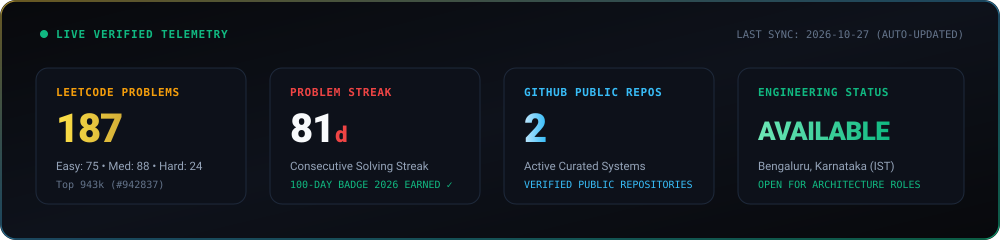
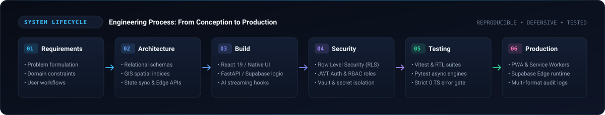
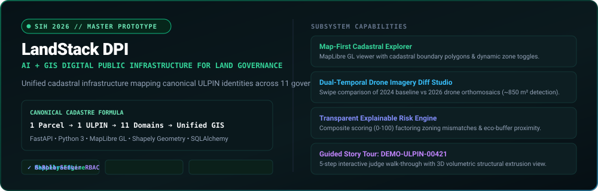
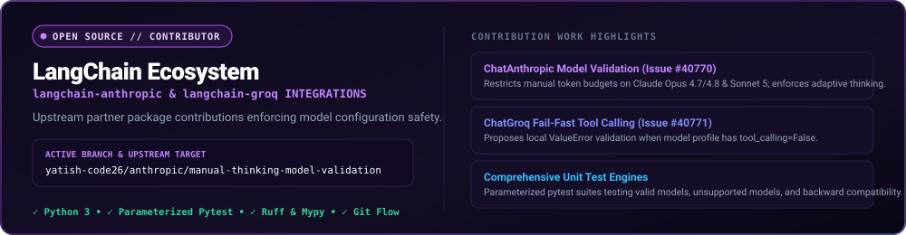
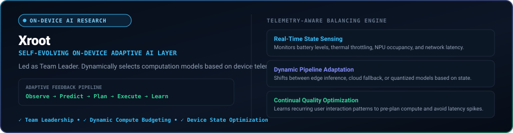
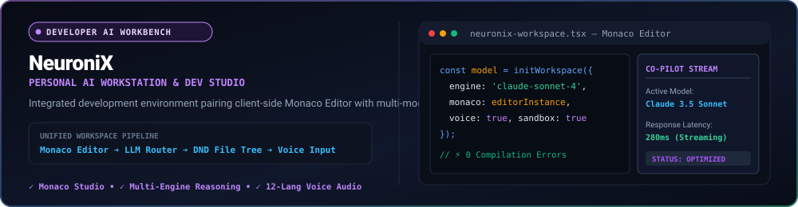
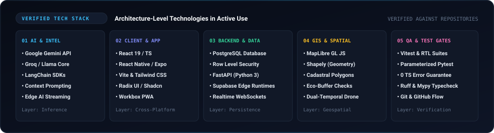

<div align="center">



<br/>

[](https://yatish-portfolio-pi.vercel.app/)
[](https://github.com/yatish-code26)
[](https://www.linkedin.com/in/yatishofficial/)
[](https://leetcode.com/u/Yatish-code/)
[](mailto:yatishofficial26@gmail.com)

</div>

<br/>

<div align="center">

<a href="https://yatish-portfolio-pi.vercel.app/">
  
</a>

</div>

<br/>


## ⚡ Executive Engineering Dossier

I am a **systems architect and product builder** based in Bengaluru, India. I specialize in engineering complete, resilient technical systems where **autonomous AI reasoning runtimes, cadastral GIS digital public infrastructure, and zero-trust PostgreSQL security** converge.

Rather than stopping at isolated frontend interfaces or disconnected prototype scripts, I design and ship vertically integrated systems: from relational database modeling with PostgreSQL Row Level Security (RLS) to spatial polygon calculus with Shapely and PostGIS, upstream model validation guards in LangChain, and responsive 3D WebGL user interfaces.

---

## 📊 Live Developer Telemetry & Contribution Summary

<!-- LIVE_STATS_START -->
<p align="center">
  
</p>

| Verified Metric | Live Measurement | Verification Authority | Source Link |
| :--- | :--- | :--- | :--- |
| **LeetCode Solved** | **182 Problems** (74 Easy • 84 Med • 24 Hard) | Official LeetCode GraphQL API | [@Yatish-code](https://leetcode.com/u/Yatish-code/) |
| **Solving Streak** | **81 Days Active Streak** (192 Active Days) | LeetCode 100-Day & 50-Day Badges | [Profile Badges](https://leetcode.com/u/Yatish-code/) |
| **Public Systems** | **2 Repositories** (LangChain OSS & Profile Engine) | GitHub REST API | [@yatish-code26](https://github.com/yatish-code26) |
| **Open Source** | **Active Contributor** (`langchain-anthropic` & `langchain-groq`) | Upstream LangChain Fork | [langchain fork](https://github.com/yatish-code26/langchain) |
| **Telemetry Cadence** | **Daily Automatic Cron** (via GitHub Actions) | Safe In-Repo Vector SVG Engine | [Workflow Run](https://github.com/yatish-code26/yatish-code26/actions) |
<!-- LIVE_STATS_END -->

> **Telemetry Update Mechanism:** The metric cards above are generated automatically by a dedicated [GitHub Actions workflow](.github/workflows/update-stats.yml). The workflow runs on a daily schedule, fetches live stats from GitHub and LeetCode, and commits the generated vector card directly to this repository with zero external third-party outages.

---


## 🛠️ Systems Engineering Lifecycle

<p align="center">
  
</p>

I approach software engineering with an unwavering commitment to **architectural completeness**:

```
[01. SPECIFICATION] ──► [02. ARCHITECTURE] ──► [03. IMPLEMENTATION]
         │                       │                        │
         ▼                       ▼                        ▼
  Domain Entity Models   Distributed Schemas       React 19 / TypeScript
  Edge Case Audits       Postgres RLS Policies     FastAPI Core Services
  Strict API Contracts   Spatial PostGIS Indices   Streaming AI Runtimes
         │                       │                        │
         ▼                       ▼                        ▼
[04. ZERO-TRUST SEC] ─► [05. VERIFICATION]  ──► [06. PRODUCTION]
         │                       │                        │
  Row Level Security     Vitest Component Tests    Workbox PWA Caching
  Server 6-Role RBAC     Parameterized Pytests     Vercel Edge Runtimes
  Secret Vault Isolation 0 TS Compiler Errors      Immutable Audit Logs
```

---


## 🚀 Verified Engineering Highlights

### 🗺️ LandStack — GIS Cadastral Digital Public Infrastructure
> **Smart India Hackathon (SIH 2026) Master Prototype**

<p align="center">
  
</p>

| Metric | Verified System Specification |
| :--- | :--- |
| **System Classification** | Integrated GIS Cadastral Digital Public Infrastructure for Land Administration |
| **Verified Tech Stack** | FastAPI, Python 3, MapLibre GL JS, Shapely, SQLAlchemy 2.0, React, PostGIS, Pytest |
| **Architectural Formula** | One Parcel ➔ One Identity (ULPIN) ➔ 11 Regulatory Domain Layers ➔ Unified GIS View |
| **Guided Scenario** | 5-Step Story Tour modeled on `DEMO-ULPIN-00421` with 3D Volumetric Extrusion View |
| **Interactive Showcase** | [Explore in 3D Web Application](https://yatish-portfolio-pi.vercel.app/) |

* **Problem Being Solved**: Public land administration across state departments suffers from acute data fragmentation: cadastral revenue maps, sub-registrar transaction deeds, town planning zoning, and municipal permissions reside in isolated silos, causing undetected encroachments and costly land disputes.
* **Architected Solution**: LandStack establishes an integrated geospatial digital public infrastructure layer linking each unique land parcel identity (ULPIN) to 11 regulatory domains through a canonical command center.
* **Engineered Subsystems**:
  * **GIS Parcel Explorer**: High-performance interactive geospatial viewer running **MapLibre GL JS** connected to a **Shapely** computational geometry engine.
  * **Dual-Temporal Drone Diff Studio**: Interactive temporal comparison comparing 2024 baseline observations with 2026 drone orthomosaics, isolating newly erected physical structure footprints (~850 m²).
  * **Explainable AI Risk Engine**: A transparent decision-support engine scoring land parcel risk from 0–100 across 6 explicit factors (master plan mismatches, lack of municipal sanction, and eco-buffer proximity).
  * **Server-Enforced RBAC & Audit Trail**: 6 discrete access roles (`CITIZEN`, `REVENUE_OFFICER`, `PLANNING_OFFICER`, `REGISTRATION_OFFICER`, `ADMIN`, `AUDITOR`) tied to immutable event logs.

---

### ⚡ LangChain Ecosystem — Upstream Open Source Contributions
> **Upstream Partner Package Integration | Active Branch**

<p align="center">
  
</p>

| Metric | Verified System Specification |
| :--- | :--- |
| **Upstream Repositories** | `langchain-ai/langchain` (Fork: [yatish-code26/langchain](https://github.com/yatish-code26/langchain)) |
| **Active Branch** | `yatish-code26/anthropic/manual-thinking-model-validation` |
| **Target Packages** | `langchain-anthropic` & `langchain-groq` |
| **Verified Scope** | Issue #40770 (Thinking Model Validation) & Issue #40771 (Fail-Fast Tool Calling) |
| **Testing Engine** | Parameterized `pytest` unit test suites, `ruff` formatting, `mypy` typing |

* **Engineering Work**:
  * **`langchain-anthropic`**: Restricting invalid manual extended thinking token budgets on Claude Opus 4.7/4.8 and Sonnet 5, enforcing adaptive thinking compliance locally before API dispatch.
  * **`langchain-groq`**: Proposing local fail-fast validation in `ChatGroq.bind_tools()` when `tool_calling=False` (e.g. `allam-2-7b`), preventing unhandled HTTP 400 exceptions from provider APIs.

---

### 🌐 3D Developer Portfolio Web Application
> **Independent Standalone Creative Application**

* **Live Deployment:** [yatish-portfolio-pi.vercel.app](https://yatish-portfolio-pi.vercel.app/)
* **Architecture:** React 19, TypeScript, Three.js, Vite. Features a cinematic 3D procedural developer avatar with kinetic entrance animation, gesture controls, pointer parallax, searchable project explorer, and verified credentials gallery.

---

### 📱 Xroot — Self-Evolving On-Device Adaptive AI
> **On-Device AI Architecture & Research Prototype**

<p align="center">
  
</p>

| Metric | Verified System Specification |
| :--- | :--- |
| **Role** | Team Leader (Team Xroot) |
| **Core Principle** | Observe ➔ Predict ➔ Plan ➔ Execute ➔ Learn (Dynamic Device Compute Balancing) |
| **Telemetry Factors** | Battery Levels, Thermal Throttling, RAM/NPU Occupancy, Network Latency, Task Urgency |

* **Problem Being Solved**: Mobile AI pipelines are static and unresponsive to changing physical device constraints, causing excessive battery drain and thermal throttling.
* **Architected Solution**: Designed an adaptive on-device AI scheduling layer that dynamically balances execution between edge quantized models and cloud inference based on real-time device telemetry.

---

### 💻 NeuroniX — Personal AI Workstation
> **Full-Stack Developer Workbench & AI Studio**

<p align="center">
  
</p>

| Metric | Verified System Specification |
| :--- | :--- |
| **System Classification** | Personal AI Assistant & Interactive Developer Studio |
| **Verified Tech Stack** | React 18, TypeScript, Vite, Monaco Code Editor, @dnd-kit, Radix UI, PWA Service Worker |
| **Core Capabilities** | Multi-domain LLM chat, in-browser Monaco code studio, drag-and-drop folder hierarchy, 12-language voice input |

---


## 🧬 Verified Technology Matrix

<p align="center">
  
</p>

| Architecture Tier | Technologies & Frameworks | Applied Capabilities |
| :--- | :--- | :--- |
| **AI & Intelligence** | `Google Gemini API`, `Groq / Llama Core`, `LangChain SDKs`, `Claude Models` | Real-time streaming AI companions, adaptive thinking validation, fail-fast tool guards |
| **Client & WebGL** | `React 19`, `TypeScript`, `Three.js`, `Vite`, `Tailwind CSS`, `Radix UI` | Raycaster 3D scenes, responsive design systems, Monaco editor integration, 0 TS errors |
| **Backend & Cloud** | `FastAPI`, `Python 3`, `PostgreSQL`, `Row Level Security`, `Supabase` | Zero-Trust Row Level Security (RLS), RESTful APIs, relational schema design, 6-role RBAC |
| **GIS & Geospatial** | `MapLibre GL JS`, `Shapely`, `PostGIS concepts` | Spatial polygon intersection calculations, cadastral parcel mapping, dual-temporal satellite change diffing |
| **Testing & Quality** | `Vitest`, `Pytest`, `React Testing Library`, `ESLint`, `Ruff`, `Mypy` | Strict 0 TypeScript errors gate, asynchronous test runners, static type analysis, parameterized unit testing |

---


## 🏆 Verified Credentials & Hackathons

Every credential listed below is grounded in verified institutional documentation and official competition records:

* 🥇 **Smart India Hackathon (SIH 2026)**: Architected **LandStack** master prototype, an integrated GIS Digital Public Infrastructure layer uniting 11 regulatory governance layers with drone change detection.
* 🏆 **Adobe Hackathon Challenge**: Official Certificate of Participation for rapid creative tooling interface engineering under timed competition constraints.
* ☁️ **Microsoft Learn Certified: Generative AI & Cloud Architecture**: Completed formal technical certification covering Generative AI model architectures, Azure cloud computing pipelines, and scalable ML workflows (`yatishp-6204`).
* 💻 **Prodothon Dec 2024 Product Sprint**: Official Certificate of Participation for rapid product flow synthesis, state machine architecture, and zero-defect frontend execution.
* 🛡️ **Fundamentals of Cryptography**: Verified Academic Certification in symmetric/asymmetric ciphers, public-key infrastructure (PKI), and SHA hash verification.
* 🔒 **Fundamentals of Information Security**: Verified Academic Certification in the CIA triad, least-privilege authorization, and row-level data boundary security.
* ⚡ **Browser Battle & HackDay 1.0**: Official Certificates of Participation for high-performance web interface prototyping and zero-latency DOM execution.
* 🎯 **LeetCode Problem Solving Milestones**: **100-Day Problem Solving Badge 2026**, **50-Days Badge 2026**, March DCC & August DCC badges with **179 verified solved problems**.

---

## 📬 Transmission Channels & Contact

Interested in discussing full-stack product architecture, AI systems, GIS public infrastructure, or open-source collaboration?

* **Live Portfolio:** [yatish-portfolio-pi.vercel.app](https://yatish-portfolio-pi.vercel.app/)
* **LinkedIn Profile:** [linkedin.com/in/yatishofficial](https://www.linkedin.com/in/yatishofficial/)
* **GitHub Profile:** [@yatish-code26](https://github.com/yatish-code26)
* **LeetCode Profile:** [@Yatish-code](https://leetcode.com/u/Yatish-code/)
* **Direct Email:** [yatishofficial26@gmail.com](mailto:yatishofficial26@gmail.com)
* **Location:** Bengaluru, Karnataka, India (IST / UTC +5:30)

<div align="center">
  <br/>
  <sub>The Digital Universe • Engineered with precision by <a href="https://github.com/yatish-code26">Yatish P</a></sub>
</div>
