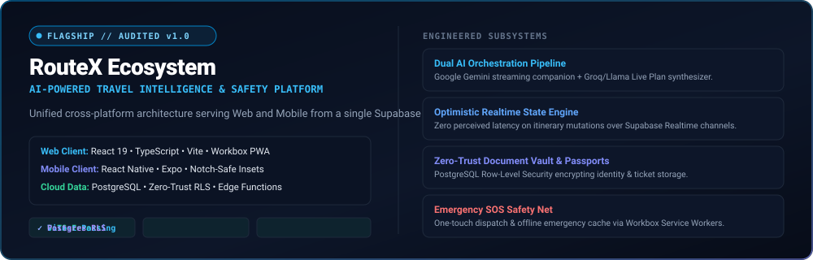
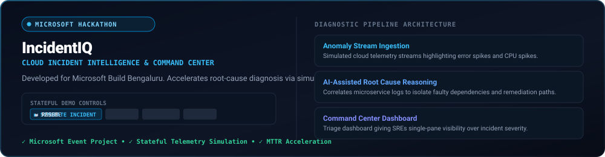

<div align="center">


<br/>

[](#-the-builders-dimension--interactive-3d-portfolio)
[](https://github.com/yatish-code26)
[](mailto:yatishofficial26@gmail.com)
[](#-featured-systems--products)
[](#-open-source-contributions)

</div>

<br/>

<a href="#-the-builders-dimension--interactive-3d-portfolio">
  
</a>

<br/>


## ⚡ Executive Engineering Dossier

I am a **product builder and systems engineer** focused on architecting end-to-end applications where **autonomous AI reasoning, cross-platform performance, and zero-trust security** converge. Rather than stopping at isolated frontend interfaces or static scripts, I design and ship complete systems from domain modeling through to database row-level security, spatial geometry calculation, and automated production test gates.

* **Flagship Platform:** Architected **[RouteX](#-routex--travel-intelligence--safety-platform)**, an audited v1.0 travel companion operating across React 19 (Web/PWA) and React Native (Mobile) powered by a single Supabase PostgreSQL cloud backend.
* **Geospatial Infrastructure:** Engineered **[LandStack](#-landstack--gis-digital-public-infrastructure)** for Smart India Hackathon (SIH 2026), connecting cadastral records and satellite/drone change detection across 11 governance layers.
* **Cloud Intelligence:** Built **[IncidentIQ](#-incidentiq--cloud-incident-intelligence)** for Microsoft Build Bengaluru, featuring an interactive incident simulation loop and AI-assisted root-cause reasoning.
* **Open Source Frameworks:** Active contributions in the **[LangChain Ecosystem](#-langchain-ecosystem--open-source-contributions)** (`langchain-anthropic` & `langchain-groq`), enforcing model thinking configuration compliance with parameterized `pytest` unit test suites.
* **On-Device AI Research:** Led **[Xroot](#-xroot--self-evolving-on-device-adaptive-ai)** as Team Leader, designing an adaptive AI runtime that dynamically chooses computation models based on real-time device telemetry.

---

## 🌐 The Builder's Dimension // Interactive 3D Portfolio

This repository includes a dedicated interactive 3D web application built with **React, TypeScript, Three.js, and Vite** located in the [`site/`](./site) directory.

### Core 3D Features:
* **Interactive 3D Engine**: A multi-layered geometric structure with an inner crystalline core, dodecahedron exoskeleton, orbiting data nodes, and spatial particle fields.
* **Pointer & Gyroscopic Parallax**: Smooth exponential lerping damping on desktop mouse hover and touch-drag rotation on mobile.
* **Spatial Project Inspector**: Interactive architecture modal drawers detailing problem formulations, verified tech stacks, and live repositories.
* **Accessibility & Performance**: Automatic WebGL availability detection with a blueprint vector fallback and strict `prefers-reduced-motion` compliance.

> **To launch the 3D Experience locally:**
> ```bash
> cd site
> npm install
> npm run dev
> ```

<br/>


## 🛠️ Systems Engineering Lifecycle

<p align="center">
  
</p>

I approach software engineering with an unwavering commitment to **architectural completeness**:

```
[01. SPECIFICATION] ──► [02. ARCHITECTURE] ──► [03. IMPLEMENTATION]
         │                       │                        │
         ▼                       ▼                        ▼
  Domain Entity Models   Distributed Schemas       React 19 / Native
  Edge Case Audits       Postgres RLS Policies     FastAPI Core Services
  Strict API Contracts   Spatial PostGIS Indices   Streaming AI Runtimes
         │                       │                        │
         ▼                       ▼                        ▼
[04. ZERO-TRUST SEC] ─► [05. VERIFICATION]  ──► [06. PRODUCTION]
         │                       │                        │
  Row Level Security     Vitest & RTL Suites       Workbox PWA Caching
  Server 6-Role RBAC     Parameterized Pytests     Supabase Edge Runtimes
  Secret Vault Isolation 0 TS Compiler Errors      Multi-Format Audits
```

1. **Defensive Persistence**: Security is enforced at the database level via PostgreSQL Row Level Security (RLS) and server-enforced role access control (RBAC), never deferred to client-side logic alone.
2. **Deterministic UI State**: High-interaction interfaces implement optimistic state updates to eliminate perceived latency during network round-trips.
3. **Automated Quality Gates**: Production deployments strictly enforce zero TypeScript compiler errors (`npx tsc --noEmit`) and comprehensive test suites (`vitest`, `pytest`).

<br/>


## 🚀 Featured Systems & Products

### ✈️ RouteX — Travel Intelligence & Safety Platform
> **Audited v1.0 Production Release | Dual Web & Mobile Ecosystem**

<p align="center">
  
</p>

| Metric | Verified System Specification |
| :--- | :--- |
| **System Classification** | Cross-Platform Travel Companion & Emergency Safety Net |
| **Verified Tech Stack** | React 19, TypeScript, Vite, Tailwind CSS, React Native, Expo, Supabase, PostgreSQL, Row Level Security, Edge Functions, Workbox PWA, Vitest |
| **Code Quality Gate** | Audited v1.0 Production Gate • 0 TypeScript Errors • Passing Vitest Test Suites • Light/Dark Semantic Token Parity |
| **Source Repositories** | [RouteX Web Platform](https://github.com/yatish-code26/RouteX-updated) • [RouteX Mobile Application](https://github.com/yatish-code26/RouteX-mobile) |

* **Problem Being Solved**: Modern travelers juggle fragmented apps for notes, disjointed currency math, unverified maps, and non-existent safety nets when connectivity drops abroad.
* **Architected Solution**: RouteX is a unified cross-platform system operating synchronously across Web (PWA) and Native Mobile clients from a consolidated Supabase backend.
* **Engineered Subsystems**:
  * **Dual AI Orchestration**: Real-time conversational streaming companion powered by **Google Gemini** alongside structured Live Plan synthesis powered by **Groq / Llama** models.
  * **Optimistic Realtime State Engine**: Real-time itinerary mutations with zero-latency optimistic updates on Supabase Realtime channels.
  * **Zero-Trust Document Vault**: Encrypted document and passport storage governed strictly by PostgreSQL Row Level Security policies.
  * **Emergency SOS Protocol**: One-touch emergency alert dispatcher coupled with offline-first protocols cached via Workbox Service Workers.
  * **Data Portability Engine**: Native browser HTML-to-PDF print generation, alongside structured CSV analytics and JSON backups.

---

### 🗺️ LandStack — GIS Digital Public Infrastructure
> **Smart India Hackathon (SIH 2026) Master Prototype**

<p align="center">
  
</p>

| Metric | Verified System Specification |
| :--- | :--- |
| **System Classification** | Integrated GIS Cadastral Digital Public Infrastructure for Land Governance |
| **Verified Tech Stack** | FastAPI, Python 3, MapLibre GL JS, Shapely, SQLAlchemy 2.0, React 18, Tailwind CSS, Pytest |
| **Architectural Formula** | One Parcel ➔ One Identity (ULPIN) ➔ 11 Regulatory Domain Layers ➔ Unified GIS View |
| **Guided Judge Scenario** | 5-Step Story Tour modeled on `DEMO-ULPIN-00421` with 3D Volumetric Extrusion View |
| **Source Repository** | [LandStack (sih-gov)](https://github.com/yatish-code26/sih-gov) |

* **Problem Being Solved**: Public land administration across state departments suffers from acute fragmentation: cadastral revenue maps, sub-registrar transaction deeds, town zoning, and municipal permissions reside in isolated silos, causing undetected encroachments and disputes.
* **Architected Solution**: LandStack establishes an integrated geospatial digital public infrastructure layer linking each unique land parcel identity (ULPIN) to 11 regulatory domains through a canonical command center.
* **Engineered Subsystems**:
  * **GIS Parcel Explorer**: High-performance interactive geospatial viewer running **MapLibre GL JS** connected to a **Shapely** computational geometry engine.
  * **Dual-Temporal Drone Diff Studio**: Interactive temporal swipe studio comparing 2024 baseline observations with 2026 drone orthomosaics, isolating newly erected physical structure footprints (~850 m²).
  * **Explainable AI Risk Engine**: A transparent decision-support engine scoring land parcel risk from 0–100 across 6 explicit factors (master plan mismatches, lack of municipal sanction, and eco-buffer proximity).
  * **Server-Enforced RBAC & Audit Trail**: 6 discrete access roles (`CITIZEN`, `REVENUE_OFFICER`, `PLANNING_OFFICER`, `REGISTRATION_OFFICER`, `ADMIN`, `AUDITOR`) tied to immutable event logs.

---

### ⚡ IncidentIQ — Cloud Incident Intelligence
> **Microsoft Build Bengaluru Hackathon / Event Project**

<p align="center">
  
</p>

| Metric | Verified System Specification |
| :--- | :--- |
| **System Classification** | Cloud Incident Intelligence & SRE Command Center |
| **Core Concept** | Telemetry Stream Correlation & MTTR Acceleration via Diagnostic AI Prompting |
| **Stateful Demo Controls** | `SIMULATE INCIDENT` • `PAUSE` • `RESUME` • `RESET` |

* **Problem Being Solved**: Complex cloud microservice incidents create high cognitive load and slow remediation cycles due to disjointed telemetry.
* **Architected Solution**: Cloud incident intelligence command-center interface with AI-assisted root-cause reasoning, real-time diagnostic telemetry views, and stateful incident simulation controls.

---

### 🧬 LangChain Ecosystem — Open Source Contributions
> **Upstream Partner Package Integration | In Progress**

<p align="center">
  
</p>

| Metric | Verified System Specification |
| :--- | :--- |
| **Upstream Repositories** | `langchain-ai/langchain` (Fork: [yatish-code26/langchain](https://github.com/yatish-code26/langchain)) |
| **Active Branch** | `yatish-code26/anthropic/manual-thinking-model-validation` |
| **Target Packages** | `langchain-anthropic` & `langchain-groq` |
| **Verified Scope** | Issue #40770 (Thinking Model Validation) & Issue #40771 (Fail-Fast Tool Calling) |
| **Testing Engine** | Parameterized `pytest` unit test suites, `ruff` formatting, `mypy` typing |

* **Engineering Work**:
  * **`langchain-anthropic`**: Restricting invalid manual extended thinking token budgets on Claude Opus 4.7/4.8 and Sonnet 5, enforcing adaptive thinking compliance with unit tests.
  * **`langchain-groq`**: Proposing local fail-fast validation in `ChatGroq.bind_tools()` when `tool_calling=False` (e.g. `allam-2-7b`), preventing HTTP 400 exceptions from provider APIs.

---

### 📱 Xroot — Self-Evolving On-Device Adaptive AI
> **On-Device AI Architecture & Research Prototype**

<p align="center">
  
</p>

| Metric | Verified System Specification |
| :--- | :--- |
| **Role** | Team Leader (Team Xroot) |
| **Core Principle** | Observe ➔ Predict ➔ Plan ➔ Execute ➔ Learn (Dynamic Device Compute Balancing) |
| **Telemetry Factors** | Battery Levels, Thermal Throttling, RAM/NPU Occupancy, Network Latency, Task Urgency |

* **Problem Being Solved**: Mobile AI pipelines are static and unresponsive to changing physical device constraints, causing excessive battery drain and thermal throttling.
* **Architected Solution**: Designed an adaptive on-device AI scheduling layer that dynamically chooses between edge quantized models and cloud inference based on real-time device telemetry.

<br/>


## 🧬 Verified Technology Matrix

<p align="center">
  
</p>

| Architecture Tier | Technologies & Frameworks | Applied Capabilities |
| :--- | :--- | :--- |
| **AI & Intelligence** | `Google Gemini API`, `Groq / Llama Core`, `LangChain SDKs`, `Claude Models` | Real-time streaming conversational agents, Live Plan itinerary generation, adaptive thinking validation |
| **Client & Mobile** | `React 19`, `React Native`, `Expo`, `TypeScript`, `Vite`, `Tailwind CSS`, `Radix UI` | Cross-platform component architecture, optimistic UI, safe-area layout engines, Workbox PWA offline caching |
| **Backend & Cloud** | `FastAPI`, `Python 3`, `Supabase`, `PostgreSQL`, `Supabase Edge Functions` | Zero-Trust Row Level Security (RLS), Supabase Realtime channels, RESTful APIs, relational schema design |
| **GIS & Geospatial** | `MapLibre GL JS`, `Shapely`, `PostGIS concepts` | Spatial polygon intersection calculations, cadastral parcel mapping, dual-temporal satellite change diffing |
| **Testing & Quality** | `Vitest`, `Pytest`, `React Testing Library`, `ESLint`, `Ruff`, `Mypy` | Strict 0 TypeScript errors gate, asynchronous test runners, static type analysis, parameterized unit testing |

<br/>


## 📊 Activity & Statistics

<div align="center">

<table border="0">
  <tr>
    <td align="center" valign="middle">
      
    </td>
    <td align="center" valign="middle">
      
    </td>
  </tr>
</table>

</div>

<br/>


## 🏆 Verified Credentials & Hackathons

* **Smart India Hackathon (SIH 2026)**: Architected **LandStack** master prototype, an integrated GIS Digital Public Infrastructure layer for state land administration.
* **Microsoft Build Bengaluru Hackathon / Event**: Architected and demoed **IncidentIQ**, a cloud incident intelligence and automated simulation command center.
* **LangChain Open Source Ecosystem**: Assigned contributor on model validation issues within `langchain-anthropic` (#40770) and `langchain-groq` (#40771).
* **Adobe Hackathon Participation**: Participated in rapid product prototyping challenge.
* **Cybersecurity & Cryptography Coursework**: Verified coursework in *Fundamentals of Information Security* and *Fundamentals of Cryptography*.
* **Algorithm & Problem Solving**: Verified LeetCode problem solving milestone recognition (50+ Solved & 100-Day Problem-Solving challenge).

---

## 📬 Transmission & Engineering Channels

Interested in discussing full-stack product architecture, AI system design, or open-source infrastructure?

* **GitHub Profile:** [@yatish-code26](https://github.com/yatish-code26)
* **Direct Email:** [yatishofficial26@gmail.com](mailto:yatishofficial26@gmail.com)
* **Location:** Bengaluru, Karnataka, India (IST / UTC +5:30)
* **LinkedIn:** Verification pending confirmation (Proposed: [linkedin.com/in/yatishofficial](https://in.linkedin.com/in/yatishofficial))

<div align="center">
  <br/>
  <sub>The Builder's Dimension • Engineered for <a href="https://github.com/yatish-code26">yatish-code26</a></sub>
</div>
