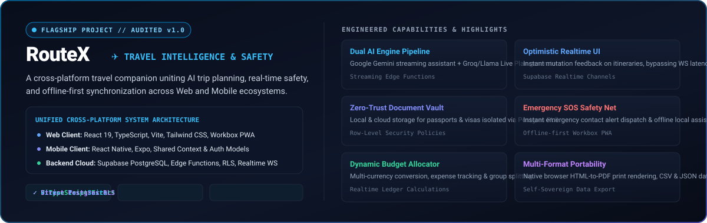
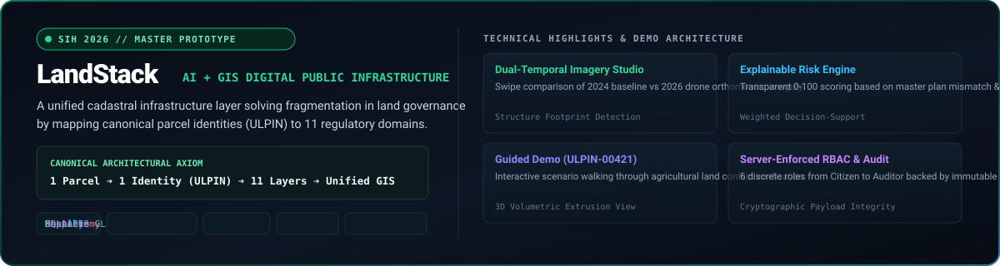
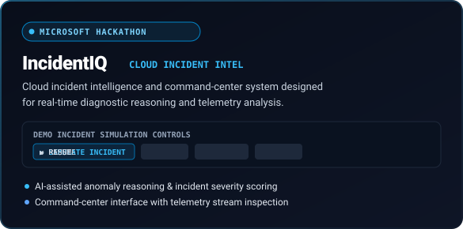
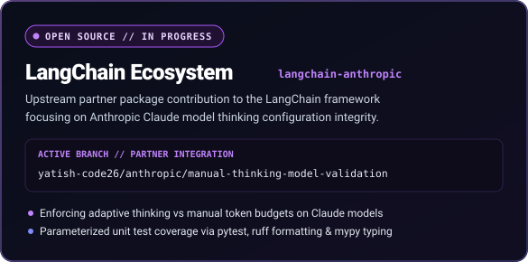

<div align="center">


<br/>

[](https://github.com/yatish-code26)
[](mailto:yatishofficial26@gmail.com)
[](#-currently-building)
[](#-open-source-contributions)

</div>

<br/>


## ⚡ Executive Summary

I am a **product builder and systems engineer** focused on architecting end-to-end applications where **AI reasoning, full-stack resilience, and strict security models** converge. Rather than stopping at isolated frontend interfaces or static scripts, I design and ship complete systems from requirements and domain modeling through to zero-trust database policies, multi-platform client applications, and production deployment pipelines.

* **Flagship Platform:** Architected **[RouteX](#-routex-flagship-project)**, a production-grade cross-platform travel intelligence and safety ecosystem powered by React 19, React Native, Supabase, and contextual AI runtimes.
* **Geospatial Infrastructure:** Engineered **[LandStack](#-landstack-sih-2026-prototype)** for Smart India Hackathon (SIH 2026), unifying cadastral records and satellite/drone change detection across 11 governance layers.
* **Open Source Contributor:** Actively contributing to the **[LangChain](#-open-source-contributions)** framework, validating adaptive reasoning constraints within the `langchain-anthropic` integration.

---

## 🛠️ Engineering Lifecycle & Philosophy

<p align="center">
  
</p>

I approach software engineering with a commitment to **architectural completeness**:

```
[01. REQUIREMENTS] ──► [02. ARCHITECTURE] ──► [03. IMPLEMENTATION]
         │                       │                        │
         ▼                       ▼                        ▼
  Domain Modeling        Distributed Schemas       React 19 / Native
  User Edge Cases        Postgres RLS Policies     FastAPI Services
  API Contracts          Spatial Geometries        Streaming AI SDKs
         │                       │                        │
         ▼                       ▼                        ▼
[04. ZERO-TRUST SEC] ─► [05. VERIFICATION]  ──► [06. PRODUCTION]
         │                       │                        │
  Row Level Security     Vitest & RTL Suites       PWA Service Workers
  JWT / RBAC Scopes      Pytest Unit Engines       Edge Functions
  Vault Isolation        0 TypeScript Errors       Multi-Format Audits
```

1. **Defensive Data Architecture**: Security is designed into the database layer via PostgreSQL Row Level Security (RLS) and server-enforced role access control (RBAC), never deferred to client-side logic alone.
2. **Deterministic UI State**: High-interaction interfaces implement optimistic state updates to eliminate perceived latency during network round-trips.
3. **Strict Quality Gates**: Zero TypeScript error tolerances (`npx tsc --noEmit`) and comprehensive unit test coverage (`vitest`, `pytest`) prior to production deployment.

<br/>


## 🚀 Featured Systems & Products

### ✈️ RouteX — Travel Intelligence & Safety Ecosystem
> **Audited v1.0 Production Platform | Web & Mobile Ecosystem**

<p align="center">
  
</p>

* **Problem**: Modern travelers face fractured workflows—planning is trapped in scattered notes, budget math is disconnected from itineraries, and emergency safety features are nonexistent when connectivity drops.
* **Architecture & Solution**: RouteX is a unified, cross-platform travel intelligence system operating synchronously across Web and Native Mobile clients from a consolidated Supabase backend.
* **Core Systems Built**:
  * **Dual AI Orchestration**: Contextual streaming travel assistance powered by **Google Gemini** alongside autonomous itinerary and Live Plan synthesis powered by **Groq / Llama** models.
  * **Optimistic Realtime State Engine**: Real-time itinerary mutations with zero-latency optimistic updates on Supabase Realtime channels.
  * **Zero-Trust Document Vault**: Encrypted document and passport storage governed strictly by PostgreSQL Row Level Security policies.
  * **Emergency SOS Protocol**: One-touch emergency alert dispatcher coupled with offline-first protocols cached via Workbox Service Workers.
  * **Data Portability Engine**: Native browser HTML-to-PDF print generation, alongside structured CSV analytics and JSON backups.
* **Verified Technical Stack**: React 19, TypeScript, Vite, Tailwind CSS, Radix UI, Supabase (PostgreSQL, Auth, Edge Functions, Realtime, RLS), React Native, Expo, Workbox PWA, Vitest.
* **Repositories**:
  * [RouteX Web Platform](https://github.com/yatish-code26/RouteX-updated)
  * [RouteX Mobile Application](https://github.com/yatish-code26/RouteX-mobile)

---

### 🗺️ LandStack — Digital Public Infrastructure for Land Governance
> **Smart India Hackathon (SIH 2026) Master Prototype**

<p align="center">
  
</p>

* **Problem**: Public land administration across state departments suffers from acute fragmentation: cadastral revenue maps, sub-registrar transaction deeds, town zoning, and municipal permissions reside in isolated silos, causing undetected encroachments and disputes.
* **Architecture & Solution**: LandStack establishes an integrated geospatial digital public infrastructure layer linking each unique land parcel identity (ULPIN) to 11 regulatory domains through a canonical command center.
* **Core Systems Built**:
  * **GIS Parcel Explorer**: High-performance interactive geospatial viewer running **MapLibre GL JS** connected to a **Shapely** geometry computational engine.
  * **Dual-Temporal Imagery Diff Studio**: Interactive temporal swipe studio comparing 2024 baseline observations with 2026 drone orthomosaics, isolating newly detected structure footprints.
  * **Explainable AI Risk Engine**: A transparent decision-support engine scoring land parcel risk from 0–100 across 6 explicit factors (master plan mismatches, lack of municipal sanction, and eco-buffer proximity).
  * **Server-Enforced RBAC & Audit Trail**: 6 discrete access roles (`CITIZEN`, `REVENUE_OFFICER`, `PLANNING_OFFICER`, `REGISTRATION_OFFICER`, `ADMIN`, `AUDITOR`) tied to immutable event logs.
  * **Story-First Guided Case**: End-to-end guided governance walkthrough modeled on parcel `DEMO-ULPIN-00421` with 3D volumetric extrusion view.
* **Verified Technical Stack**: FastAPI, Python 3, MapLibre GL JS, Shapely, SQLAlchemy 2.0, React 18, Tailwind CSS, Pytest.
* **Repository**: [LandStack (sih-gov)](https://github.com/yatish-code26/sih-gov)

---

### ⚡ Technical Hackathon & Event Projects

<table>
  <tr>
    <td width="50%" valign="top">
      
      <br/><br/>
      <strong>IncidentIQ — Cloud Incident Intelligence</strong><br/>
      <em>Microsoft Build Bengaluru Event Project</em>
      <ul>
        <li><strong>Concept:</strong> Cloud incident intelligence and command-center system designed to streamline real-time telemetry diagnostics and root-cause analysis.</li>
        <li><strong>Key Features:</strong> AI-assisted anomaly reasoning, telemetry stream inspector, and interactive demo simulation state controls (<code>SIMULATE INCIDENT</code>, <code>PAUSE</code>, <code>RESUME</code>, <code>RESET</code>).</li>
        <li><strong>Focus:</strong> Reducing MTTR through contextual diagnostic reasoning.</li>
      </ul>
    </td>
    <td width="50%" valign="top">
      
      <br/><br/>
      <strong>LangChain — Model Validation Contribution</strong><br/>
      <em>Upstream Open Source Work (In Progress)</em>
      <ul>
        <li><strong>Repository:</strong> <a href="https://github.com/yatish-code26/langchain">yatish-code26/langchain</a> (Forked from <code>langchain-ai/langchain</code>)</li>
        <li><strong>Branch:</strong> <code>yatish-code26/anthropic/manual-thinking-model-validation</code></li>
        <li><strong>Package:</strong> <code>libs/partners/anthropic/langchain_anthropic</code></li>
        <li><strong>Engineering Work:</strong> Restricting invalid manual extended thinking configurations on Claude Opus and Sonnet models, enforcing adaptive thinking compliance with parameterized <code>pytest</code> unit tests.</li>
      </ul>
    </td>
  </tr>
</table>

<br/>


## 🧬 Verified Technology Matrix

<p align="center">
  
</p>

| Architecture Tier | Technologies & Frameworks | Applied Capabilities |
| :--- | :--- | :--- |
| **AI & Intelligence** | `Google Gemini API`, `Groq / Llama`, `LangChain`, `Claude Models` | Real-time streaming conversational agents, Live Plan itinerary generation, adaptive thinking validation |
| **Client & Mobile** | `React 19`, `React Native`, `Expo`, `TypeScript`, `Vite`, `Tailwind CSS`, `Radix UI` | Cross-platform component architecture, optimistic UI, safe-area layout engines, Workbox PWA offline caching |
| **Backend & Cloud** | `FastAPI`, `Python 3`, `Supabase`, `PostgreSQL`, `Supabase Edge Functions` | Zero-Trust Row Level Security (RLS), Supabase Realtime channels, RESTful APIs, relational schema design |
| **GIS & Geospatial** | `MapLibre GL JS`, `Shapely`, `PostGIS concepts` | Spatial polygon intersection calculations, cadastral parcel mapping, dual-temporal satellite change diffing |
| **Testing & Quality** | `Vitest`, `Pytest`, `React Testing Library`, `ESLint`, `Ruff`, `Mypy` | Strict 0 TypeScript errors gate, asynchronous test runners, static type analysis, parameterized unit testing |

<br/>


## 📊 Activity & Statistics

<div align="center">

<table border="0">
  <tr>
    <td align="center" valign="middle">
      
    </td>
    <td align="center" valign="middle">
      
    </td>
  </tr>
</table>

</div>

<br/>


## 🏆 Verified Credentials & Hackathons

* **Smart India Hackathon (SIH 2026)**: Designed and developed **LandStack** master prototype, an integrated GIS Digital Public Infrastructure layer for state land administration.
* **Microsoft Build Bengaluru Hackathon / Event**: Architected and demoed **IncidentIQ**, a cloud incident intelligence and automated simulation command center.
* **Adobe Hackathon Participation**: Participated in rapid product prototyping challenge.
* **Cybersecurity & Cryptography**: Verified coursework in *Fundamentals of Information Security* and *Fundamentals of Cryptography*.
* **Algorithm & Problem Solving**: Verified LeetCode problem solving milestone recognition (50+ Solved & 100-Day Problem-Solving challenge).

---

## 📬 Contact & Engineering Inquiries

Interested in discussing full-stack product architecture, AI system design, or open-source collaboration?

* **GitHub Profile:** [@yatish-code26](https://github.com/yatish-code26)
* **Email:** [yatishofficial26@gmail.com](mailto:yatishofficial26@gmail.com)
* **Location:** Bengaluru, India

<div align="center">
  <br/>
  <sub>Crafted with engineering rigor • Designed for <a href="https://github.com/yatish-code26">yatish-code26</a></sub>
</div>
